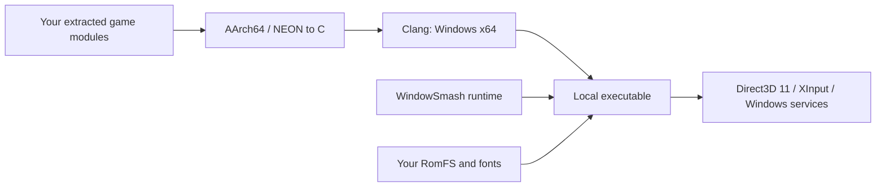

<p align="center">
  
</p>

<p align="center">
  <a href="docs/BUILDING.md"><strong>Build guide</strong></a> ·
  <a href="https://github.com/SNO2207/WindowSmash/releases"><strong>Windows releases</strong></a> ·
  <a href="docs/TECHNICAL.md"><strong>How it works</strong></a> ·
  <a href="NETPLAY.md"><strong>Netplay</strong></a> ·
  <a href="docs/DLC-AND-UNLOCKS.md"><strong>DLC &amp; unlocks</strong></a> ·
  <a href="docs/UPDATES.md"><strong>Later versions</strong></a> ·
  <a href="README-LINUX.md"><strong>Linux</strong></a>
</p>

---

## The project

WindowSmash translates the game's AArch64 CPU code into C ahead of time, compiles it for Windows x64, and links it with a purpose-built runtime. That runtime supplies the operating-system services, controller input, file access, audio interfaces, graphics translation, and networking the game expects.

The result is a locally built Windows executable backed by your own extracted game data. The original game logic still comes from your game files; this repository provides the recompiler and runtime source.

> **Source tree and runtime releases are separate.** The Git source tree contains no game executable, recompiled game functions, assets, firmware fonts, keys, or saves. A prebuilt Windows runtime is available under [Releases](https://github.com/SNO2207/WindowSmash/releases); supply your own matching game data and fonts using the [runtime setup guide](docs/RUNTIME-SETUP.md).

## What is inside

| Component | What it does |
| :--- | :--- |
| **Ahead-of-time recompiler** | Discovers guest functions, lifts AArch64 and NEON instructions to C, and incrementally compiles module code with Clang. |
| **Native Windows runtime** | Maps module images, resolves symbols, dispatches guest calls, and implements selected console services with Windows APIs. |
| **Direct3D 11 renderer** | Processes guest GPU commands, translates Maxwell shaders to HLSL, and manages textures, render targets, and compute work. |
| **Asynchronous shader compilation** | Uses dedicated compiler threads, a persistent DXBC cache, and a separate D3D device to warm driver compilation. |
| **Local Wireless relay** | Carries the game's existing Local Wireless traffic over a UDP relay, with host/join launchers and a standalone relay option. |
| **Developer tools** | Includes instruction and function differential tests, disassembly helpers, symbol lookup, archive readers, captures, and profiling tools. |

## Status

The current implementation targets **game version 11.0.0** and **Windows x64**. Later versions, such as **13.0.5** with Kazuya and Sora, can be built from your own update package with `tools/update.py` ([later game versions](docs/UPDATES.md)). `tools/install_version.py` installs and builds a version in a folder of its own with one command, and the launchers ask which built version to start ([several game versions](docs/VERSIONS.md)). An experimental **Linux x64** build is cross-compiled from the same source ([Linux](README-LINUX.md)). The local development build has reached menus, rendered gameplay, loaded fighter modules natively, and exercised the Local Wireless connection path. It is an experimental port, not a broadly validated release.

| Area | Current position |
| :--- | :--- |
| CPU and loading | AArch64-to-C translation, native symbol replacements, and deferred loading of compiled fighter modules are implemented. |
| Graphics | D3D11 rendering and shader caching are implemented. Shader translation, driver behavior, and first-use compilation remain compatibility risks. |
| Controllers | One local player per instance, using the first XInput controller or the keyboard. |
| Audio and movies | Optional static libopus and libvpx integration; functionality depends on the build configuration. |
| DLC | Installed-content reporting and module extraction support the content present in the supplied game version. The 11.0.0 target contains fighters through Pyra/Mythra. |
| Multiplayer | Relay-backed Local Wireless is implemented. Complete two-PC matches and the full DLC/stage roster have not been comprehensively verified. |

There is no Nintendo online-service integration, general Switch compatibility claim, verified performance target, or bundled game-data download.

## Download and run

**[Get the Windows x64 runtime →](https://github.com/SNO2207/WindowSmash/releases)**

Extract the runtime ZIP, run **Configure Game Data.bat** to select your own compatible RomFS and firmware fonts, then use **Play SSBU.bat**. The runtime ZIP has the compiled files needed to execute the game; it excludes source, debug maps, object files, caches, saves, keys, and game-data archives. A compiler and Python are not required to play.

See **[runtime setup](docs/RUNTIME-SETUP.md)** for fresh installs and updates. Developers can build the runtime themselves using the next section.

## Build your copy

You will need Windows 10/11 x64, an AVX2/FMA/F16C-capable CPU, a D3D11-capable GPU, Python 3.14, and a Visual Studio C++/Clang toolchain. Keep generous free disk space: game data, generated C, object files, and linker maps are separate allocations.

```powershell
git clone https://github.com/SNO2207/WindowSmash.git
cd WindowSmash
py -3.14 -m pip install -r requirements.txt
```

Prepare your ExeFS, patched RomFS, and firmware fonts as described in the **[complete build guide](docs/BUILDING.md)**. Then extract the embedded fighter modules and build:

```powershell
python tools/arc.py nro
python tools/recomp.py all dump/exefs --out build --jobs 16
```

Choose a job count appropriate to your CPU and available memory. The output is `build/ssbu.exe`; generated files and game inputs remain ignored by Git.

### Linux (experimental)

The same game can also be built as a native x86-64 Linux program, cross-compiled on Windows from the Windows build's generated C. The renderer stays Direct3D 11, running on Vulkan through DXVK, with shaders compiled by vkd3d-shader; SDL2 handles the window, controllers and sound. `tools/linux/package_linux.py` turns the build into a folder to copy to the Linux machine, with launchers that find your game data there. See **[Linux](README-LINUX.md)** for the toolchain, the build commands, and running it, including in a virtual machine.

## Play and connect

### Multiplayer setup

1. Put the same WindowSmash release/build and game version on both PCs. Configure each PC's own data and keep separate player IDs.
2. **Online lobby:** put the lobby's address in `online_server.txt` and run **Play SSBU.bat**. Every Local Wireless room created in that lobby appears in the Rooms List of players with the same game version; nobody forwards a port.
3. **Private room:** the host runs **Host SSBU Netplay.bat**, chooses a room name, permits incoming UDP, and shares the displayed address. The friend runs **Join SSBU Netplay.bat**, enters that address and the same room name.
4. Both open **Local Wireless** in-game. The host creates a room; the friend selects it and the host accepts.

**[Complete multiplayer setup, VPN/port-forwarding options, and troubleshooting →](NETPLAY.md)**

| Launcher | Use |
| :--- | :--- |
| [`Play SSBU.bat`](Play%20SSBU.bat) | Start the game and join the online lobby in `online_server.txt`; it plays offline if the lobby does not answer or the file says `off`. |
| [`Play SSBU Offline.bat`](Play%20SSBU%20Offline.bat) | Start an offline session. |
| [`Host SSBU Netplay.bat`](Host%20SSBU%20Netplay.bat) | Run the relay and host a Local Wireless room. |
| [`Join SSBU Netplay.bat`](Join%20SSBU%20Netplay.bat) | Connect to a host or a standalone relay. |
| [`Unlock All Fighters.bat`](Unlock%20All%20Fighters.bat) | Back up and edit your own compatible save while the game is closed. |

For multiplayer, use matching game versions and build revisions, use the same lobby (and lobby code) or relay room name, and open **Local Wireless** in the game. See the [networking guide](NETPLAY.md) for the online lobby, firewall, UPnP, VPN, and standalone-relay details.

<details>
<summary><strong>Keyboard and controller controls</strong></summary>

The first XInput controller maps face buttons by physical position. On an Xbox controller, **B** corresponds to Nintendo **A**.

| Input | Mapping |
| :--- | :--- |
| Left stick | Arrow keys |
| A / B / X / Y | Z / X / C / V |
| L / R | A / S |
| ZL / ZR | Q / W |
| Plus / Minus | Enter / Backspace |
| Right stick | I / J / K / L |
| Overlay / details / screenshot | F1 / F2 / F3 |

</details>

## Under the hood



The **[technical guide](docs/TECHNICAL.md)** explains the CPU state model, function discovery, relocation and symbol binding, service shims, GPU command path, shader compilation fix, relay protocol, save handling, and the role of every tool in `tools/`.

## Working on WindowSmash

```powershell
python -m pip install -r requirements-dev.txt
python -m unittest discover -s tests -v
```

The source-only tests exercise packaging and save-editing behavior with synthetic fixtures. They require no game data and do not launch the game. Windows PowerShell is used for the unlock-tool tests. Game-backed instruction and function differential tests are documented separately in the [technical guide](docs/TECHNICAL.md#verification-and-debugging).

When reporting a problem, include the game version, GPU/driver, build revision, reproduction steps, and a short relevant log excerpt. Review logs for local paths, player names, and network addresses before posting. Keep extracted content, generated game code, keys, and saves out of issues and pull requests.

## Repository boundaries

`runtime/` and `tools/` are source. `build/`, `dump/`, `data/`, `save/`, caches, captures, and local bundles are generated or private inputs and are ignored. The local full-install bundler is for managing your own build; public runtime releases use the smaller file set described in [runtime setup](docs/RUNTIME-SETUP.md).

See [third-party notices](NOTICE.md) for attribution and licensing information. No project-wide license has been specified for the remaining source. Super Smash Bros. Ultimate and related names belong to their respective owners. WindowSmash is an independent project and is not affiliated with Nintendo.
