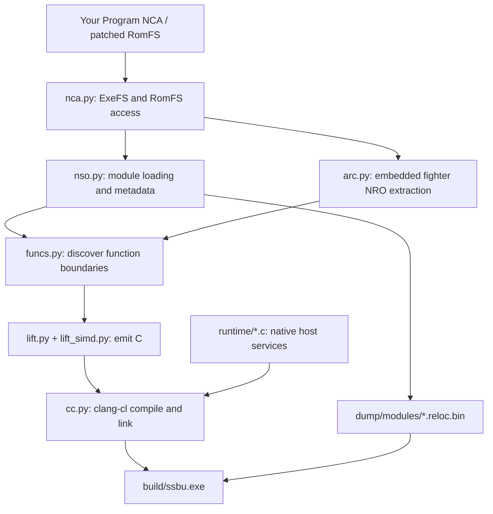
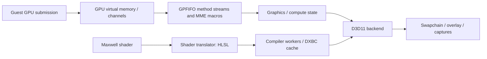

# How WindowSmash works

> Inherited architecture reference. SmashRollback's target design and unproven capabilities are specified in [FSD](FSD.md), [ADRs](../adr/README.md) and [milestones](../milestones/README.md).

[README](../README.md) · [Build guide](BUILDING.md) · [Multiplayer](../NETPLAY.md) · [DLC and saves](DLC-AND-UNLOCKS.md)

WindowSmash is a static recompiler plus a Windows compatibility runtime, specialized for this game. CPU code is translated before launch. GPU programs are translated when encountered. Selected operating-system and SDK entry points are implemented natively, while the remaining game and SDK code executes as compiled guest functions.

This document describes the checked-in implementation. Implemented paths and developer test tools should not be read as a compatibility guarantee for every mode, fighter, stage, or machine.

## 1. From extracted modules to a Windows executable



### Inputs and discovery

[`nca.py`](../tools/nca.py) reads package headers, ExeFS containers, and RomFS tables using keys supplied locally. [`nso.py`](../tools/nso.py) handles module decompression and dynamic metadata, including imports, exports, relocations, and information useful for ELF conversion.

[`funcs.py`](../tools/funcs.py) finds function entries from exception-frame tables, exported function symbols, relocations into executable memory, initialization arrays, direct call targets, and recognizable import stubs. These sources provide more structure than a linear disassembly alone. Exception metadata also supplies extents used by the recompiler.

Fighter modules live inside `data.arc`. [`arc.py`](../tools/arc.py) resolves hashed archive paths and reads the compressed filesystem metadata. Its `nro` command extracts known modules from `prebuilt:/nro/release/`. The known-name list is version-specific; a name being listed does not mean its bytes exist in a particular archive.

### Translation

[`recomp.py`](../tools/recomp.py) orchestrates image preparation, C emission, incremental compilation, and linking. Each guest function becomes a C function accepting a `Cpu *` context. [`lift.py`](../tools/lift.py) emits integer/control-flow operations; [`lift_simd.py`](../tools/lift_simd.py) handles AdvSIMD/NEON operations with explicit vector lanes.

[`runtime/recomp.h`](../runtime/recomp.h) defines the shared contract:

- 31 general registers, the guest stack pointer, 32 vector registers, FP control/status, and thread-local register state.
- Guest memory operations expressed as host accesses to the mapped guest addresses.
- Function lookup for guest code pointers and cached indirect branch targets.
- Helpers for atomics, arithmetic, floating-point behavior, traps, and exception transitions.

Direct branches can target generated C labels/functions. Indirect calls resolve guest code addresses to native function pointers. Tail-call helpers keep supported guest tail transfers from accumulating unnecessary host stack frames. Unsupported instructions or unavailable targets can produce a trap; they do not establish complete instruction coverage.

The build disables floating-point contraction and fast-math-style assumptions to preserve guest arithmetic behavior. `clang-cl` produces x64 object files, then links them with the native runtime and Windows libraries.

### Stable module placement

The primary modules have explicit guest bases in `recomp.py`: `main`, `subsdk0`, and `sdk`. Extracted NRO modules receive aligned address ranges, recorded locally in `dump/nro/bases.txt`. The generated registry binds build IDs to the matching compiled module.

That address manifest is a build input. Preserve it when incrementally rebuilding an existing installation; generated code and relocation images must agree on placement.

With several game versions in one checkout ([several versions](VERSIONS.md)), `module_bases.txt` at the checkout root keeps one address per build ID across all version folders. A module that is byte-identical between versions then gets the same address everywhere, and [`modcache.py`](../tools/modcache.py) reuses its generated C and objects from another version's build instead of building it again.

## 2. Loading, symbols, and guest execution

[`host.c`](../runtime/host.c) maps `*.reloc.bin` images at their expected guest addresses, registers module ranges, publishes exports, resolves imports, and applies symbol relocations. Function metadata associates guest addresses with compiled host functions.

Native replacements use `HLE(symbol)` declarations. The build detects those names and redirects applicable guest entry points to runtime implementations. Unresolved strong imports receive diagnostic handlers rather than silently acquiring arbitrary implementations.

Startup enters the guest SDK initialization path and eventually `nnMain`. Guest execution runs on a Windows thread with a large reserved stack. Modules loaded later through `nn::ro` are matched by build ID, mapped, bound, and initialized when requested.

[`hle_ro.c`](../runtime/hle_ro.c) can save an unrecognized module image into the local NRO dump directory. Harvesting a module does not compile it: a later rebuild must translate and link it. The runtime's missing-module behavior is a development aid, not a substitute for preparing the full module set.

### Exceptions and non-local control flow

The guest's own unwind implementation interprets guest exception metadata. [`hle_unwind.c`](../runtime/hle_unwind.c) bridges its final register/context transfer to the corresponding recompiled host frame using a structured host exception and landing-pad filters. [`hle_setjmp.c`](../runtime/hle_setjmp.c) and [`hle_fiber.c`](../runtime/hle_fiber.c) implement related control-flow bridges.

## 3. Native services

| Source | Responsibility |
| :--- | :--- |
| [`kernel.c`](../runtime/kernel.c) | Guest thread contexts, synchronization, handle/state tracking, memory operations, and supported supervisor calls. |
| [`ipc.c`](../runtime/ipc.c), `ipc_*.c` | Service request handling and selected audio, display, Mii, and related interfaces. |
| [`hle_fs.c`](../runtime/hle_fs.c) | RomFS reads, save/cache mounts, and host file operations. |
| [`hle_env.c`](../runtime/hle_env.c), [`hle_applet.c`](../runtime/hle_applet.c) | Account/environment behavior, applet-facing functions, and installed add-on reporting. |
| [`hle_hid.c`](../runtime/hle_hid.c) | First-controller XInput polling, keyboard input, and optional scripted input. |
| [`hle_pl.c`](../runtime/hle_pl.c) | Shared-font loading from locally supplied `.bfttf` files. |
| [`hle_nv.c`](../runtime/hle_nv.c) | Supported GPU-driver interfaces, address mapping, and channel operations. |
| [`hle_net.c`](../runtime/hle_net.c), [`net_relay.c`](../runtime/net_relay.c) | Virtual networking, Local Wireless, socket behavior, relay transport, and optional UPnP. |
| [`hle_offline.c`](../runtime/hle_offline.c) | Selected offline service behavior needed by the target game. |

These are targeted service implementations, not a complete implementation of the console OS. Some functions return fixed or limited behavior appropriate to the supported paths.

### Files and fonts

`dump/modules/romfs.cfg` contains two lines: a host file path, then the byte offset at which an unencrypted RomFS begins. Relative paths resolve against the game's working directory. The runtime reads RomFS metadata and game files in place rather than extracting all assets.

Save data and cache files are host directories. `SSBU_DATA_ROOT` can redirect those per-run files for testing. A network identity is separate from save contents: copying `netplay_id.txt` to another PC can make two installs appear as the same player.

The font service loads six firmware font files, decodes their container format, and maps shared font memory. Fonts are user-supplied runtime inputs, not repository assets.

## 4. The graphics path



[`gpu.c`](../runtime/gpu.c) parses Tegra/Maxwell command streams, engine bindings, method writes, macros, transfers, synchronization, and dispatch/draw events. [`gpu_host1x.c`](../runtime/gpu_host1x.c) covers the Host1x/video-related job path. The backend interface separates command/state handling from rendering.

[`gpu_d3d11.c`](../runtime/gpu_d3d11.c) creates D3D resources, tracks render targets and pipeline state, uploads or retains guest buffers, handles graphics/compute work, and presents the result. [`gpu_texture.c`](../runtime/gpu_texture.c) contains texture-format/layout helpers. [`gpu_shader.c`](../runtime/gpu_shader.c) decodes guest shader instructions and emits HLSL.

### Shader compilation and the driver fix

CPU code is compiled ahead of time; GPU shaders remain demand-driven. A new shader is translated to HLSL, then queued for compilation. Persisted DXBC cache loads have priority over new HLSL compiles.

The current implementation uses up to 16 dedicated compiler workers with 64 MiB reserved stacks. The `SSBU_COMPILE_THREADS` environment variable controls the worker count within the implementation's limits. Shader cache entries include a translation-version marker and relevant shader/state hashes.

The shader fix addresses driver compilation on small internal worker stacks. A second D3D11 device, created with internal threading optimizations disabled, warms driver compilation on WindowSmash's own compiler threads. The rendering device retains its normal threading behavior. Compilation stages and current jobs are retained for crash reporting.

This is a targeted mitigation, not a claim of driver-independent behavior. Rendering work with unavailable shaders can be skipped while compilation is pending. First-use hitches, incomplete visuals, or translation failures still need investigation on each supported path.

### Audio and video

`ipc_audio.c` supplies the audio-service path; `ipc_opus.c` can use a statically linked libopus build. The video path reconstructs VP9 frame information and can use libvpx for decode. [`gpu_vp9.c`](../runtime/gpu_vp9.c) contains frame/header logic; its default probability tables carry [libvpx attribution](../NOTICE.md).

These optional codecs are selected at build time. Their presence is not implied by a successful core build.

## 5. Multiplayer transport

The game continues to run its own Local Wireless session logic. WindowSmash presents a virtual LAN and carries UDP payloads through a relay. This does not replace the game's netcode with rollback networking or Nintendo matchmaking.

[`net_relay.c`](../runtime/net_relay.c) implements both the game-side client and the integrated host relay of a private room. [`ssbu_relay.py`](../tools/ssbu_relay.py) is the online lobby: the same transport, plus room lists. The default UDP port is `39420`, and virtual addresses are allocated within `10.13.0.0/16`.

The protocol (version 2) uses a short magic/version/type header, big-endian fields, join/welcome/member messages, keepalive ping/pong, forwarded data, leave messages, and the lobby's list/listing/list-end messages. A join carries the main module's build id, so players of different game versions never meet. A private relay's rooms hold at most eight members; the game's selected mode can impose a smaller player limit. Peers silent for ten seconds are removed.

The lobby gives every player an address of its own and partitions players by build id and lobby code (`SSBU_NET_ROOM`; `smash`, the default, is the public lobby). `nn::ldn`'s scan asks the lobby for its room list and waits up to 500 ms for it. Room membership is derived from the Local Wireless messages the lobby relays, and a room's traffic passes only between that room's players. The client accepts join answers only from the host it asked, and adverts, departures and kicks only from the network's host. A lobby that has not answered for five seconds counts as offline: Local Wireless then reports itself unavailable, as without netplay.

Lobby codes and room names are routing identifiers, not passwords. The protocol is not encrypted or an authenticated public service. Use it with trusted players and a reachable relay. A virtual LAN can simplify connectivity when the host cannot accept inbound UDP directly. Follow the [multiplayer setup guide](../NETPLAY.md).

## 6. DLC and fighter unlocks

The target game's content archive already contains assets and code for the DLC available in that version. `aoc.cfg` reports locally installed add-on indices to `nn::aoc`; it does not add newer game data. DLC fighter NROs must also be extracted and compiled.

The unlock tools edit the known save layout of 11.0.0, which 13.0.5 shares; they identify a version folder by its program's build ID, validate the fighter tables, and create a backup. Base-game selection flags and associated milestones are separate from installed DLC reporting. Mii Fighters may still need to be created in-game. See the [DLC/save guide](DLC-AND-UNLOCKS.md) for usage and limitations.

## 7. Tool reference

Paths below are relative to the repository root. Diagnostic tools may require `requirements-dev.txt` and locally prepared game inputs. Several modules are libraries imported by the driver rather than general user commands.

### Build and content preparation

| Tool | Role |
| :--- | :--- |
| [`nca.py`](../tools/nca.py) | Inspect packages; extract ExeFS/RomFS files; generate `romfs.cfg` and installed-content `aoc.cfg`. |
| [`arc.py`](../tools/arc.py) | Inspect `data.arc`, extract named paths, and collect known embedded NRO modules. Requires Python 3.14. |
| [`update.py`](../tools/update.py) | Apply an update package as a layered RomFS in a version folder, checking every block against the update's hashes ([later versions](UPDATES.md)). |
| [`install_version.py`](../tools/install_version.py) | Install and build a game version in a folder of its own with one command ([several versions](VERSIONS.md)). |
| [`modcache.py`](../tools/modcache.py) | Share module addresses and reuse module builds across version folders by build ID. |
| [`nso.py`](../tools/nso.py) | Read NSO/NRO images and dynamic metadata; inspect modules and export ELF representations. |
| [`funcs.py`](../tools/funcs.py) | Discover functions and optionally write a function inventory. |
| [`recomp.py`](../tools/recomp.py) | Run `coverage`, `emit`, `image`, `build`, `compile`, `link`, the end-to-end `all` driver, the `check` of unresolved imports, or `wrap-sig` for a hook's code signature. |
| [`lift.py`](../tools/lift.py) | AArch64 integer/control-flow lifting implementation. |
| [`lift_simd.py`](../tools/lift_simd.py) | NEON/AdvSIMD lifting implementation. |
| [`a64.py`](../tools/a64.py) | Shared instruction-emission helpers, register expressions, types, and unsupported-operation handling. |
| [`cc.py`](../tools/cc.py) | Find `clang-cl`, construct compile options, compile incrementally, and link Windows executables. |

### Analysis and diagnostics

| Tool | Role |
| :--- | :--- |
| [`disasm.py`](../tools/disasm.py) | Disassemble an address range, optionally beside lifted C output. |
| [`calls.py`](../tools/calls.py) | List a function's direct calls and name imported callees. |
| [`census.py`](../tools/census.py) | Summarize imported/exported SDK boundaries and dynamically requested NVN entry points. |
| [`insn_census.py`](../tools/insn_census.py) | Count decoded instruction forms in a module's text. |
| [`ipc_reach.py`](../tools/ipc_reach.py) | Trace direct-call reachability to service IPC boundaries; indirect calls make its result a lower bound. |
| [`eh.py`](../tools/eh.py) | Inspect exception-frame information and C++ landing-pad tables. |
| [`find_crc.py`](../tools/find_crc.py) | Find the CRC-32 table and code references to it. |
| [`strrefs.py`](../tools/strrefs.py) | Report strings referenced by instructions in a range. |
| [`sym.py`](../tools/sym.py) | Resolve module-relative offsets to nearby exported function symbols. |
| [`hostsym.py`](../tools/hostsym.py) | Resolve host executable offsets using a locally generated linker map. |
| [`sass.py`](../tools/sass.py) | List or count Maxwell shader instructions in dumped shader binaries. |
| [`hlslc.py`](../tools/hlslc.py) | Compile an HLSL file through Windows D3DCompiler and report diagnostics. |
| [`shot.py`](../tools/shot.py) | Convert captured BMP frames to PNG and summarize colors. |

### Verification, automation, and player utilities

| Tool | Role |
| :--- | :--- |
| [`difftest.py`](../tools/difftest.py) | Compare lifted single-instruction behavior against Unicorn across sampled CPU states. |
| [`functest.py`](../tools/functest.py) | Compare selected whole leaf functions against Unicorn, including registers and memory writes. |
| [`shadertest.c`](../tools/shadertest.c) | Translate dumped guest shaders and compile their HLSL with D3DCompiler. |
| [`vp9test.c`](../tools/vp9test.c) | Replay recorded NVDEC jobs through the VP9 path and libvpx. |
| [`vp9rt.c`](../tools/vp9rt.c) | Exercise VP9 header reconstruction with an independently parsed synthetic clip. |
| [`menurun.sh`](../tools/menurun.sh) | Script menu navigation, captures, and logging using a copied test save. |
| [`autobattle.sh`](../tools/autobattle.sh) | Drive a timed menu-to-battle input sequence for local diagnostics. |
| [`netpair.sh`](../tools/netpair.sh) | Run two local instances through loopback relay transport with separate copied test data. |
| [`ssbu_relay.py`](../tools/ssbu_relay.py) | Run a standalone UDP relay without the game, native runtime, or game files. |
| [`bundle_ssbu.py`](../tools/bundle_ssbu.py) | Stream a local build into a portable ZIP64, rewrite the RomFS location, and verify CRC/SHA-256. |
| [`unlock_all.py`](../tools/unlock_all.py) | Validate, back up, and unlock the compatible local save using Python. |
| [`Unlock-All-Fighters.ps1`](../tools/Unlock-All-Fighters.ps1) | Equivalent Windows save-unlock helper, with a running-game guard and atomic backup/replacement. |
| [`Configure-Game-Data.ps1`](../tools/Configure-Game-Data.ps1) | Configure a runtime release using a separately supplied RomFS, fonts, and optional installed-content config. |
| [`pick_version.bat`](../tools/pick_version.bat) | Let the launchers list the built game versions and ask which to start. |
| [`smoke.ps1`](../smoke.ps1) | Compile and execute a small known game-function smoke harness against prepared local inputs. |

The `.sh` helpers expect a Unix-like shell/tool environment that can run the Windows executable. They recreate their named output/test directories; use disposable capture paths. They are developer scripts, not required player launchers.

## Verification and debugging

Source-only checks:

```powershell
python -m unittest discover -s tests -v
```

Game-backed checks after preparing local modules:

```powershell
python tools/recomp.py coverage dump/exefs/main --jobs 8
python tools/difftest.py dump/exefs/main --jobs 8
python tools/functest.py dump/exefs/main --jobs 8
```

Differential results apply to the sampled encodings, states, and functions. Whole-function tests deliberately skip reference runs that cannot complete in isolation; neither test is proof that every game path works.

The overlay exposes frame/rendering counters. F1 toggles the overlay, F2 shows details, F3 captures a frame, F4 requests draw diagnostics, and F6 triggers a sampling profile. Locally generated linker maps are useful to `hostsym.py` and profiling tools, but are not required to run a release build.

Useful environment variables include `SSBU_DATA_ROOT`, `SSBU_SHADER_CACHE`, `SSBU_COMPILE_THREADS`, `SSBU_DUMP_SHADERS`, `SSBU_DUMP_HLSL`, `SSBU_INPUT`, `SSBU_CAPTURE`, and the [network variables](../NETPLAY.md#environment-reference). Several other `SSBU_*` switches are implementation-level debugging controls; consult their use sites before enabling them.

## Build boundaries

Checked-in code defines the recompiler and native runtime. Local game inputs supply the guest program and assets. A runtime release contains the compiled executable/module images but still requires separately supplied game data and fonts. Generated C, binaries, caches, captures, local bundles, and personal data stay out of the Git source tree.
